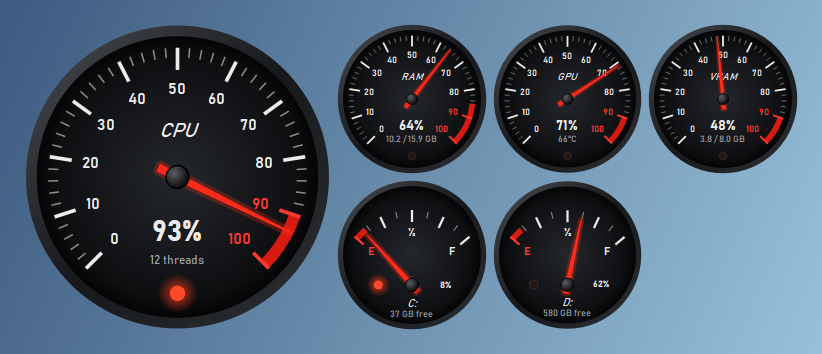
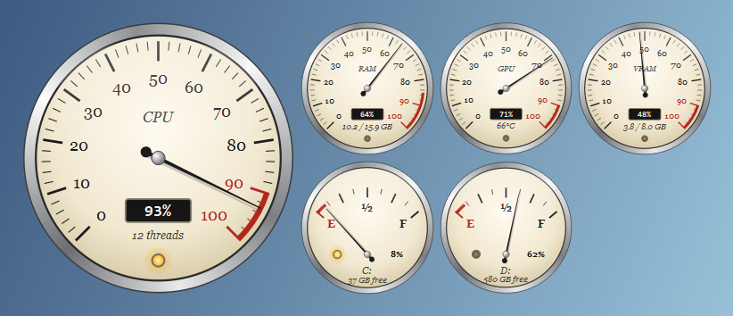
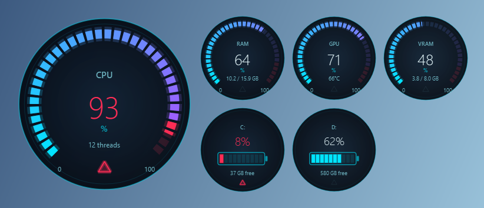
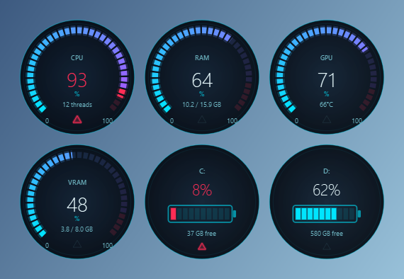
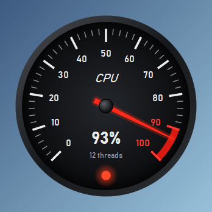

# PCDash

A car-dashboard overlay for your Windows PC: live system stats drawn as
tachometers, dials and fuel gauges, floating on your desktop in a transparent,
always-on-top window.



| Retro | Futuristic |
| --- | --- |
|  |  |

## Features

- **CPU** usage as the big main tachometer, with a redline zone near 100%
- **RAM** usage (% plus GB used / total)
- **GPU** usage and **VRAM** (plus GPU temperature on NVIDIA cards)
  - NVIDIA: read via NVML (`nvidia-ml-py`)
  - AMD / Intel: read from Windows performance counters, the same source
    Task Manager uses
- **Disk free space** per fixed drive (C:, D:, …) as fuel gauges, E to F
- **Warning lamps**: CPU ≥ 90%, RAM ≥ 85%, GPU ≥ 95%, VRAM ≥ 90%,
  drive ≤ 10% free
- **Three styles**, switchable while running:
  - **Sporty**: dark face, red needle and redline, sharp DIN-style numbers
  - **Retro**: cream face, black serif numbers, chrome bezel, thin needle,
    amber jewel warning lamps
  - **Futuristic**: EV-style digital cluster with glowing segmented neon arcs,
    big digital numbers, no needle; drives shown as battery bars
- Needles that ease smoothly toward each new value instead of jumping
- **Four layouts**: Dashboard, Row, Grid, Single gauge; choose which gauges
  are shown and which one is the main gauge

  | Grid | Single gauge |
  | --- | --- |
  |  |  |

- Frameless, transparent, always-on-top window you can drag anywhere
- **Click-through** mode so clicks go to whatever is underneath, toggled with
  a global hotkey
- Adjustable **opacity** and **size**
- **System tray** icon with the full menu and live CPU/RAM/GPU in its tooltip
- Optional **Start with Windows**
- Settings (position, size, style, layout, …) remembered between launches
- Low overhead (about 0.2% total CPU): stats are read once a second on a
  background thread, needles animate only while moving, nothing animates while
  the overlay is hidden, and each gauge's static face is cached as an image

## Requirements

- Windows 10 or 11
- Python 3.13

## Install

```bash
git clone <your-repo-url> PCDash
cd PCDash
py -3.13 -m venv .venv
.venv\Scripts\python.exe -m pip install -r requirements.txt
```

## Run

With a console window (shows log output, handy while trying things out):

```bash
.venv\Scripts\python.exe main.py
```

Without a console window (normal use):

```bash
.venv\Scripts\pythonw.exe main.py
```

To start it automatically when you log in, tick **Start with Windows** in the
tray menu.

Try the styles and warning lamps with fake, moving data:

```bash
.venv\Scripts\python.exe main.py --demo
```

PCDash lives in the system tray (bottom-right; it may be hidden under the
**^** arrow). **Left-click** the tray icon to show/hide the overlay,
**right-click** it for the menu.

### Controls

| Action | How |
| --- | --- |
| Move the overlay | Left-drag it |
| Menu | Right-click the overlay or the tray icon |
| Resize | Ctrl + mouse wheel over the overlay, or Settings → Size |
| Opacity | Shift + mouse wheel over the overlay, or Settings → Opacity |
| Click-through on/off | **Ctrl+Alt+F10** (anywhere) or menu → Click-through |
| Show/hide overlay | **Ctrl+Alt+F11** (anywhere) or left-click the tray icon |
| Style, layout, gauges | Menu → Style / Layout / Main gauge / Gauges |
| Quit | Menu → Quit PCDash |

While click-through is on, the overlay ignores the mouse completely. Use the
hotkey or the tray menu to turn it off again.

### Settings file

Settings are saved automatically to `%APPDATA%\PCDash\config.json`. Most
options are in the Settings window; a few advanced ones are only in the file
(quit PCDash before editing it):

| Key | Default | Meaning |
| --- | --- | --- |
| `hotkey_click_through` | `"Ctrl+Alt+F10"` | Modifiers `Ctrl`, `Alt`, `Shift`, `Win` + a key (`A`–`Z`, `0`–`9`, `F1`–`F24`, `Home`, `PageUp`, …) |
| `hotkey_show_hide` | `"Ctrl+Alt+F11"` | Same format |
| `poll_ms` | `1000` | How often stats are read (250–10000 ms) |
| `animation_fps` | `30` | Needle frame rate while moving (10–144) |
| `gpu_backend` | `"auto"` | `"auto"`, `"nvml"` (NVIDIA) or `"pdh"` (Windows counters) |

Delete the file to reset everything to defaults. A log is written next to it
(`pcdash.log`).

## Troubleshooting

- **No GPU gauges**: neither NVML nor the Windows GPU counters were
  available. Check `pcdash.log` for the reason; updating the graphics driver
  usually helps.
- **"Hotkey unavailable"**: another program already uses that key
  combination. Pick a different one in `config.json`.
- **Overlay is gone**: press Ctrl+Alt+F11 or left-click the tray icon. If it
  was on a monitor that is no longer connected, it moves back to the main
  screen automatically.
- **"PCDash is already running"**: only one copy can run at a time; look for
  the tray icon.

## Screenshots

The images in this README are generated, so they look the same on any PC:

```bash
.venv\Scripts\python.exe tools\make_screenshots.py
```

This renders every style with fixed demo values into `docs/screenshots/`.
Run it again after changing a style, and commit the updated PNGs.

To capture the real overlay on your own desktop instead:

1. Start PCDash (use `--demo` if you want the warning lamps to light up).
2. Press **Win+Shift+S**, choose the rectangle mode and drag around the
   overlay. The capture is copied to the clipboard; click the notification
   to save it as a PNG.
3. Put the file in `docs/screenshots/` and reference it from this README, e.g.
   ``.

## Development

```bash
.venv\Scripts\python.exe -m pip install -r requirements-dev.txt
.venv\Scripts\python.exe -m pytest
```

GitHub Actions runs the tests on Windows for every push and pull request
(`.github/workflows/ci.yml`).

### Project layout

```
main.py                         entry point (--demo, --version)
pcdash/
  app.py                        startup: logging, settings, single-instance lock
  controller.py                 ties overlay, tray, hotkeys and settings together
  overlay.py                    frameless transparent always-on-top window + layouts
  settings_dialog.py            Settings window
  config.py                     Settings dataclass, JSON load/save
  win32.py                      click-through and global hotkeys (Win32 API)
  autostart.py                  "Start with Windows" (HKCU Run key)
  icon.py                       tray/app icon drawn in code
  stats_poller.py               polls the provider on a background thread
  providers/
    base.py                     DataProvider interface (MetricSpec, Reading)
    pc_stats.py                 CPU / RAM / GPU / disk stats
    gpu.py                      GPU backends: NVML and Windows perf counters
    demo.py                     fake data for --demo and screenshots
  gauges/
    gauge_widget.py             needle smoothing + cached static layer
    styles/
      base.py                   GaugeStyle interface + geometry helpers
      sporty.py                 Sporty style
      retro.py                  Retro style
      futuristic.py             Futuristic style
tools/make_screenshots.py       regenerates docs/screenshots/
tests/                          pytest suite
```

Data sources and drawing are kept separate: a `DataProvider` only reports
numbers (`MetricSpec` + `Reading`), and a `GaugeStyle` only draws them, so
new stats or new styles can be added without touching the other side.

### Adding a style

1. Create `pcdash/gauges/styles/mystyle.py` with a `GaugeStyle` subclass that
   sets `key` and `name` and implements `paint_dial_background`,
   `paint_dial_foreground`, `paint_fuel_background` and `paint_fuel_foreground`.
   Background methods draw the static parts (they are cached); foreground
   methods draw the needle/value every frame.
2. Add the class to `STYLES` in `pcdash/gauges/styles/__init__.py`.

It then shows up in the Style menu and the Settings window automatically.

## License

[MIT](LICENSE)
